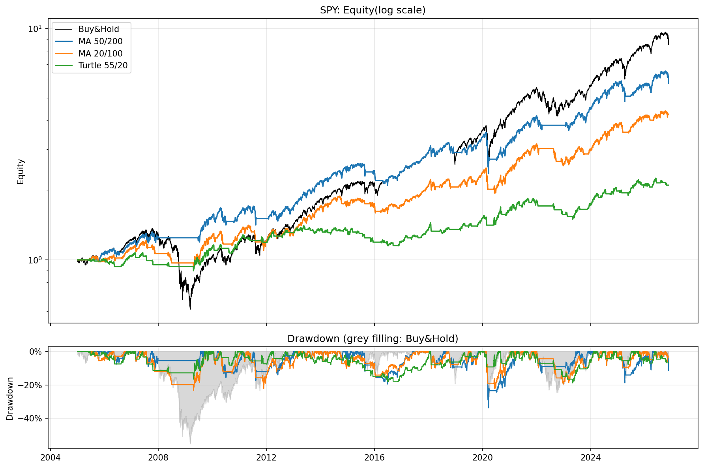
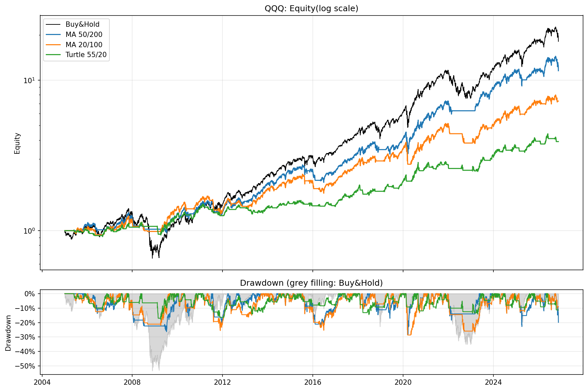

# strategyBacktest

I wanted to see how well the classic trend-following rules actually hold up against simply buying and holding, so I wrote a small backtester in Python to find out. It runs a few strategies on a handful of ETFs, charges a trading cost on every trade, and compares everything with Buy & Hold.

It's a learning project. I'm not claiming to have found anything you could trade for real. Most of the work went into getting the basics right: no peeking into the future, and costs included.

## What it does

- Downloads prices with `yfinance` and caches them in `data/`, so reruns are fast
- Runs three strategies:
  - **MA 50/200**: be in the market when the 50-day moving average is above the 200-day one, otherwise stay in cash
  - **MA 20/100**: the same idea with faster windows
  - **Turtle 55/20**: a Donchian channel breakout. Buy when price breaks the 55-day high, sell when it drops below the 20-day low
- Compares each one with Buy & Hold
- Takes 0.1% off every trade (easy to change)
- Reports CAGR, max drawdown, Sharpe ratio and number of trades
- Draws an equity chart (log scale) with a drawdown panel underneath

## Charts

SPY:



QQQ:



The top panel is the equity curve on a log scale. The bottom one shows drawdowns, and the grey area is Buy & Hold.

## Results

I ran everything on SPY, QQQ, GLD, TLT and EEM, from 2005-01-01 until now, with a 0.1% cost per trade.

**Sharpe ratio**

| | SPY | QQQ | GLD | TLT | EEM |
|---|---|---|---|---|---|
| Buy&Hold | 0.613 | 0.720 | 0.595 | 0.271 | 0.355 |
| MA 50/200 | 0.658 | 0.738 | 0.576 | 0.203 | 0.212 |
| MA 20/100 | 0.616 | 0.658 | 0.528 | 0.401 | 0.458 |
| Turtle 55/20 | 0.435 | 0.627 | 0.415 | 0.128 | 0.203 |

**Maximum drawdown**

| | SPY | QQQ | GLD | TLT | EEM |
|---|---|---|---|---|---|
| Buy&Hold | -0.552 | -0.534 | -0.456 | -0.484 | -0.664 |
| MA 50/200 | -0.337 | -0.286 | -0.358 | -0.275 | -0.514 |
| MA 20/100 | -0.233 | -0.286 | -0.420 | -0.188 | -0.396 |
| Turtle 55/20 | -0.188 | -0.180 | -0.299 | -0.420 | -0.359 |

**CAGR (average yearly return)**

| | SPY | QQQ | GLD | TLT | EEM |
|---|---|---|---|---|---|
| Buy&Hold | 0.103 | 0.142 | 0.097 | 0.029 | 0.062 |
| MA 50/200 | 0.084 | 0.119 | 0.077 | 0.017 | 0.022 |
| MA 20/100 | 0.068 | 0.095 | 0.068 | 0.039 | 0.064 |
| Turtle 55/20 | 0.035 | 0.064 | 0.043 | 0.007 | 0.018 |

**Number of trades** (a buy and a sell count as two)

| | SPY | QQQ | GLD | TLT | EEM |
|---|---|---|---|---|---|
| MA 50/200 | 21 | 25 | 28 | 40 | 33 |
| MA 20/100 | 56 | 54 | 70 | 69 | 60 |
| Turtle 55/20 | 136 | 126 | 106 | 102 | 116 |

## What I took from it

The clearest result is risk. In all 15 strategy and market combinations, the maximum drawdown is smaller than Buy & Hold's. On SPY, for example, Buy & Hold went down 55% in 2008-2009, while the strategies dropped between 19% and 34%.

Returns are a different story. Buy & Hold earns more almost everywhere. The only exceptions are TLT and EEM, where MA 20/100 comes out slightly ahead, and on EEM the gap is so small (0.062 vs 0.064) that I'd call it a tie.

On Sharpe ratio the strategies win in a few spots. The difference is clear for TLT and EEM with MA 20/100. On SPY and QQQ, MA 50/200 edges out Buy & Hold, but by so little that I wouldn't read anything into it.

Turtle 55/20 did worst. This is a simplified version (more on that below), and it trades a lot, so the 0.1% cost per trade adds up over 100+ trades.

My rough reading: trend filters seem to help on assets that had long bad stretches, like bonds and emerging markets. On things that mostly went up, like SPY and QQQ, they mainly make the ride smoother and cost you some return.

## Avoiding look-ahead bias

This is the mistake that makes most naive backtests look great, so I was careful about it. A signal for day *t* uses the closing price of day *t*, which means you can only act on it the next day. That's what `signal.shift(1)` does inside `backtest`.

While building this I also computed a version without the shift. It looks better on the chart, which is exactly the problem. The shift lives in one shared function, so no strategy can accidentally skip it.

The Turtle channel also uses only previous days' prices. Otherwise today's price could never break its own maximum.

## Running it

You need `numpy`, `pandas`, `yfinance` and `matplotlib`.

With Nix:

```
nix-shell
python3 main.py
```

Without Nix:

```
pip install numpy pandas yfinance matplotlib
python3 main.py
```

Tickers, start date and cost are variables (`tickers`, `startpoint`, `cost`) at the bottom of `main.py`. Create a `plots/` folder first, since that's where the charts get saved.

## How the code is organized

| Function | What it does |
|---|---|
| `load_prices` | downloads prices and caches them as csv |
| `rolling_strategy`, `turtle_trading` | return a signal: 0 or 1 for every day |
| `backtest` | shifts the signal, subtracts costs, returns daily strategy returns |
| `metrics` | CAGR, max drawdown, Sharpe, number of trades |
| `run_ticker` | runs every strategy on one ticker |
| `plot_ticker` | equity and drawdown chart |

To add a strategy, write a function that returns a 0/1 signal and add one line to the `signals` dictionary in `run_ticker`. It then shows up in the tables and charts automatically.

## Limitations

I'd rather list these than have anyone over-trust the numbers:

- It's one time period and five markets. SPY and QQQ move together a lot, so there are fewer independent tests than it looks like. Sharpe differences of 0.02-0.05 are probably noise.
- There's no out-of-sample test yet. Splitting the history into two halves is the next thing I want to do.
- I used standard parameters and didn't tune them, which is good, but I also haven't checked how sensitive the results are to them.
- Long-only. No leverage, no shorting.
- Money sitting in cash earns nothing here. In real life it would earn interest, so the strategies look a bit worse than they should.
- Turtle is simplified. It uses closing prices only instead of daily highs and lows, and has none of the original position sizing.
- The cost is a flat 0.1%. No slippage, spreads or taxes.
- A year is assumed to have 252 trading days, which is wrong for markets that trade every day, like BTC-USD.
- The csv cache never refreshes. Delete the file in `data/` to pull fresh prices.
- Data comes from `yfinance`, which is free and occasionally wrong.

## Disclaimer

This is a learning project, not investment advice. Past performance says little about the future.
